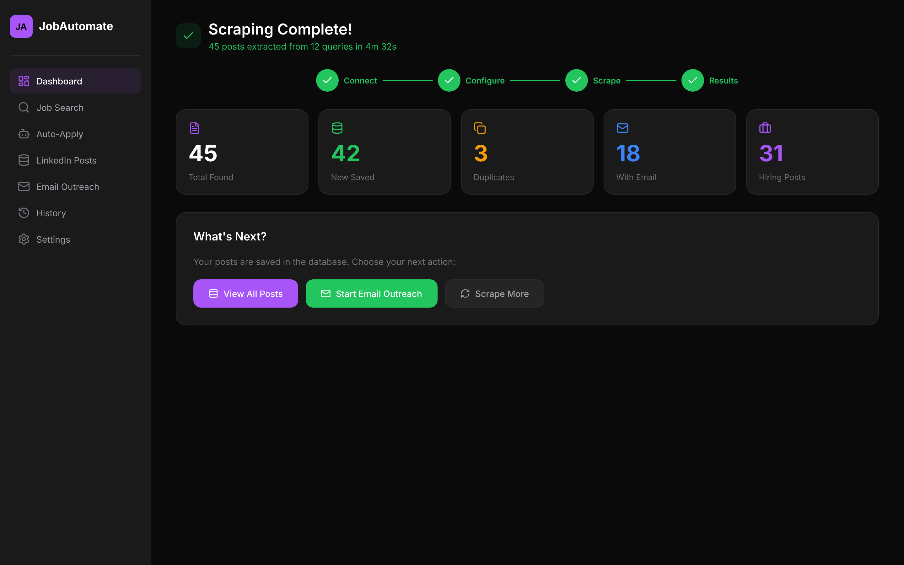

# YouTube Thumbnail Design Specification
## JobAutomate — AI-Powered LinkedIn Job Auto-Applier

---

## Overview

- **Resolution**: 1280 x 720 px (16:9, YouTube standard)
- **Target audience**: Developers, job seekers, AI/ML engineers
- **Goal**: Drive clicks from YouTube search results and suggested videos
- **Core message**: An AI bot applies to LinkedIn jobs automatically, so you do not have to

---

## Chosen Concept: "Split Layout — Frustration vs. Automation"

Of the three concept directions, the split layout performs best for this audience because it creates an immediate visual contrast that exploits the curiosity gap. Left side shows the painful status quo; right side shows the solution. This mirrors the "Before/After" thumbnail pattern, which is consistently high-performing in the dev/tool space.

---

## Layout Diagram

```
┌───────────────────────────────────────────────────────────────────┐
│  LEFT THIRD (40%)              RIGHT TWO-THIRDS (60%)             │
│                                                                   │
│  ┌──────────────────┐          ┌─────────────────────────────┐    │
│  │                  │          │  APP SCREENSHOT (angled)    │    │
│  │  PERSON FACE     │   ──►    │  ┌─────────────────────┐    │    │
│  │  (frustrated,    │          │  │  Scraping Complete! │    │    │
│  │   looking left)  │          │  │  45 Found  42 Saved │    │    │
│  │                  │          │  │  [green stats]      │    │    │
│  └──────────────────┘          │  └─────────────────────┘    │    │
│                                └─────────────────────────────┘    │
│  PRIMARY TEXT (center-left):                                      │
│                                                                   │
│      AI Applies to                                                │
│      Jobs FOR You                                                 │
│                                                                   │
│  SUBTITLE (below primary):                                        │
│      LinkedIn + AI + Auto-Apply                                   │
│                                                                   │
│  ┌──────────────┐                          ┌────────────────┐     │
│  │  Open Source │  (bottom left badge)     │  JobAutomate  │     │
│  └──────────────┘                          └────────────────┘     │
└───────────────────────────────────────────────────────────────────┘
```

### Zone Breakdown

| Zone | Content | Purpose |
|------|---------|---------|
| Top-left | Person face (frustrated expression) | Emotional hook — faces get 38% more clicks |
| Center | Bold primary text | Message delivery |
| Right 60% | Angled app screenshot (8c_Scraper_Results.png) | Social proof — real product |
| Bottom-left | "Open Source" badge | Trust signal for developer audience |
| Bottom-right | JobAutomate logo/wordmark | Brand recall |
| Background | Dark gradient with subtle grid/glow | Matches app theme, feels premium |

---

## Text Hierarchy

### Primary Text (Hero)
- **Copy**: "AI Applies to Jobs FOR You"
- **Size**: ~120–140px, weight 900 (Black / ExtraBlack)
- **Color**: White (#FFFFFF) with "FOR You" in yellow (#FACC15) for emphasis
- **Style**: All caps or title case, no letter spacing reduction
- **Placement**: Center-left, spanning rows 2–4 of a 6-row grid

### Secondary Text (Subtitle)
- **Copy**: "LinkedIn + AI + Auto-Apply"
- **Size**: ~44px, weight 600
- **Color**: #A3A3A3 (muted white) or #22C55E (green accent)
- **Placement**: Directly below primary text, left-aligned

### Badge — Open Source
- **Copy**: "Open Source"
- **Size**: ~28px, weight 700
- **Background**: #7C3AED (purple) with white text
- **Border-radius**: 6px
- **Placement**: Bottom-left, clear of YouTube timestamp zone (avoid bottom-right corner)

### Logo Wordmark
- **Copy**: "JobAutomate"
- **Size**: ~24px, weight 600
- **Color**: White on semi-transparent dark pill (#FFFFFF on rgba(255,255,255,0.08))
- **Placement**: Bottom-right (this is brand territory, not information territory — keep small)

---

## Color Palette

| Role | Color | Hex |
|------|-------|-----|
| Background (primary) | Near-black | #0D0D0F |
| Background (gradient end) | Deep purple-black | #110A1F |
| Accent — Purple | Brand purple | #7C3AED |
| Accent — Green | Success / stats | #22C55E |
| Primary text | White | #FFFFFF |
| Emphasis word | Yellow | #FACC15 |
| Subtitle text | Muted white | #A3A3A3 |
| Glow / bloom | Purple glow | rgba(124, 58, 237, 0.35) |
| App screenshot border | Purple-tinted | #2D1F4E |

### Color Rationale
- Dark background matches the app UI exactly, creating visual continuity when viewers click through
- Yellow on the key word "FOR You" breaks the white monotony and draws the eye to the most psychologically loaded word
- Green reinforces the "success/done" feeling — same green used in the app's stat cards
- Purple glow behind the screenshot creates depth and frames the product naturally

---

## Visual Elements

### Background
- Base: solid #0D0D0F
- Gradient overlay: radial gradient from #1A0A2E (top-center) to #0D0D0F (edges)
- Optional: subtle dot-grid or circuit-board texture at 4% opacity — reinforces the tech/dev aesthetic without cluttering

### App Screenshot Treatment
- Source: `8c_Scraper_Results.png` (Results screen — shows "Scraping Complete!", stat cards with 45/42/31 numbers)
- Transform: 10–15 degree perspective tilt (right edge pulled back, CSS `perspective: 1200px; rotateY(-12deg)`)
- Drop shadow: `0 30px 80px rgba(124, 58, 237, 0.45)` — purple glow matches brand
- Border: 1px solid #2D1F4E, border-radius 12px
- Size: approximately 520 x 300px in the rendered thumbnail
- Placement: right side, vertically centered, slightly overlapping center zone

### Divider / Separator
- Vertical gradient line between left (face) zone and right (app) zone
- Color: linear gradient from #7C3AED (top) to #22C55E (bottom)
- Width: 3px, height: 80% of thumbnail height
- This arrow-shaped divider visually encodes "before → after"

### Purple Glow Bloom
- Position: behind the app screenshot, centered on right third
- Shape: radial, soft
- Color: rgba(124, 58, 237, 0.3)
- Size: ~500px diameter
- Renders the screenshot as "glowing" and futuristic

### LinkedIn Logo Reference (optional)
- Small LinkedIn "in" icon (official blue #0A66C2) in the subtitle line, between "LinkedIn" and "+"
- Size: ~36px
- Adds instant recognition for the platform being automated

---

## HTML/CSS Render Code

This code renders at 1280x720. Scale down for preview (e.g., `transform: scale(0.5)` from a 2560x1440 container).

```html
<!DOCTYPE html>
<html>
<head>
  <meta charset="UTF-8" />
  <link rel="preconnect" href="https://fonts.googleapis.com" />
  <link href="https://fonts.googleapis.com/css2?family=Inter:wght@400;600;700;900&display=swap" rel="stylesheet" />
  <style>
    * { margin: 0; padding: 0; box-sizing: border-box; }
    body { width: 1280px; height: 720px; overflow: hidden; background: #0D0D0F; }
  </style>
</head>
<body>

<div style="
  width: 1280px;
  height: 720px;
  background: radial-gradient(ellipse at 30% 50%, #1A0A2E 0%, #0D0D0F 65%);
  display: flex;
  align-items: center;
  padding: 60px 64px;
  position: relative;
  font-family: 'Inter', system-ui, sans-serif;
  overflow: hidden;
">

  <!-- Subtle dot-grid texture overlay -->
  <div style="
    position: absolute;
    inset: 0;
    background-image: radial-gradient(circle, rgba(255,255,255,0.04) 1px, transparent 1px);
    background-size: 28px 28px;
    pointer-events: none;
  "></div>

  <!-- Purple glow bloom behind screenshot -->
  <div style="
    position: absolute;
    right: 100px;
    top: 50%;
    transform: translateY(-50%);
    width: 560px;
    height: 560px;
    background: radial-gradient(circle, rgba(124,58,237,0.30) 0%, transparent 70%);
    pointer-events: none;
  "></div>

  <!-- LEFT ZONE: Face placeholder + text -->
  <div style="
    flex: 0 0 480px;
    display: flex;
    flex-direction: column;
    justify-content: center;
    gap: 18px;
    z-index: 2;
  ">

    <!-- Person face area (replace with actual image) -->
    <div style="
      width: 160px;
      height: 160px;
      border-radius: 50%;
      background: linear-gradient(135deg, #2D1F4E, #1A1A2E);
      border: 3px solid #7C3AED;
      box-shadow: 0 0 30px rgba(124,58,237,0.4);
      display: flex;
      align-items: center;
      justify-content: center;
      font-size: 72px;
      margin-bottom: 8px;
    ">
      <!-- Replace this div with:  -->
      😤
    </div>

    <!-- Primary text -->
    <div>
      <div style="
        font-size: 76px;
        font-weight: 900;
        color: #FFFFFF;
        line-height: 1.0;
        letter-spacing: -1px;
        text-shadow: 0 4px 24px rgba(0,0,0,0.6);
      ">
        AI Applies to<br/>
        Jobs
        <span style="color: #FACC15;"> FOR You</span>
      </div>
    </div>

    <!-- Subtitle -->
    <div style="
      font-size: 28px;
      font-weight: 600;
      color: #22C55E;
      letter-spacing: 0.5px;
      display: flex;
      align-items: center;
      gap: 10px;
    ">
      <!-- LinkedIn icon -->
      <span style="
        background: #0A66C2;
        color: white;
        font-size: 18px;
        font-weight: 700;
        padding: 2px 7px;
        border-radius: 4px;
      ">in</span>
      LinkedIn + AI + Auto-Apply
    </div>

  </div>

  <!-- Vertical divider line -->
  <div style="
    flex: 0 0 3px;
    height: 480px;
    background: linear-gradient(to bottom, #7C3AED, #22C55E);
    border-radius: 2px;
    margin: 0 36px;
    z-index: 2;
    box-shadow: 0 0 12px rgba(124,58,237,0.5);
  "></div>

  <!-- RIGHT ZONE: App screenshot -->
  <div style="
    flex: 1;
    display: flex;
    align-items: center;
    justify-content: center;
    z-index: 2;
  ">
    <div style="
      transform: perspective(1200px) rotateY(-12deg) rotateX(3deg);
      border-radius: 12px;
      border: 1.5px solid #2D1F4E;
      box-shadow:
        0 30px 80px rgba(124,58,237,0.45),
        0 8px 24px rgba(0,0,0,0.7);
      overflow: hidden;
      width: 520px;
    ">
      <!-- Replace src with actual screenshot path -->
      
    </div>
  </div>

  <!-- BADGE: Open Source (bottom-left) -->
  <div style="
    position: absolute;
    bottom: 44px;
    left: 64px;
    background: #7C3AED;
    color: #FFFFFF;
    font-size: 22px;
    font-weight: 700;
    padding: 8px 20px;
    border-radius: 6px;
    letter-spacing: 0.5px;
    box-shadow: 0 4px 20px rgba(124,58,237,0.5);
    z-index: 3;
  ">
    Open Source
  </div>

  <!-- LOGO: JobAutomate (bottom-right) -->
  <div style="
    position: absolute;
    bottom: 44px;
    right: 64px;
    background: rgba(255,255,255,0.07);
    border: 1px solid rgba(255,255,255,0.12);
    color: #FFFFFF;
    font-size: 22px;
    font-weight: 600;
    padding: 8px 20px;
    border-radius: 8px;
    letter-spacing: 0.3px;
    z-index: 3;
  ">
    JobAutomate
  </div>

</div>

</body>
</html>
```

---

## A/B Testing Variations

### Variation A — "Split Layout" (Primary, spec above)
The recommended design. Emotional face on the left, product proof on the right, bold white + yellow text center. Best for broad YouTube search impressions.

### Variation B — "Terminal Aesthetic" (Developer-focused)
- Full dark background with green terminal text scrolling (based on 8b_Scraper_Live_Log.png)
- Primary text: "I Automated 500 Job Applications"
- Color: Green (#22C55E) monochrome on black — hacker/dev aesthetic
- No face — text and product only
- Target: developers who respond to the terminal visual language
- Risk: lower CTR from non-developer audience segments

```
┌─────────────────────────────────────────────────────┐
│  > scraping linkedin jobs...                        │
│  > 45 found. 42 saved. applying...          [GREEN] │
│                                                     │
│   I AUTOMATED                                       │
│   500 JOB APPS                  [screenshot        │
│                                   right side]      │
│  [Open Source]           [JobAutomate]              │
└─────────────────────────────────────────────────────┘
```

### Variation C — "Big Number" (Curiosity-driven)
- Primary text: "45 Jobs Applied. 0 Effort."
- Huge "45" in yellow dominates left half
- App screenshot floats on right
- No face
- Works well when the number itself is the hook

```
┌─────────────────────────────────────────────────────┐
│                                                     │
│        45              [App screenshot]             │
│   JOBS APPLIED.                                     │
│    0 EFFORT.                                        │
│                                                     │
│  [Open Source]           [JobAutomate]              │
└─────────────────────────────────────────────────────┘
```

---

## Platform-Specific Adjustments

| Platform | Adjustment |
|----------|-----------|
| YouTube (primary) | 1280x720 — use full spec as written |
| Twitter/X | Crop to 1200x675 — safe to use same layout, trim 22.5px top and bottom |
| LinkedIn | Resize to 1200x627 — increase subtitle font size by 15%, logo badge slightly larger |
| Thumbnail preview (small) | At 320x180 (YouTube mobile list view), ensure primary text is still legible — test at this size |

---

## Implementation Notes

1. **Face image**: Replace the emoji placeholder in the HTML with an actual PNG of a frustrated/surprised face. A stock photo or illustrated avatar both work. Crop to 160x160, circular mask.

2. **Screenshot path**: Update `src="8c_Scraper_Results.png"` to the absolute or relative path of the screenshot at render time.

3. **Font fallback**: Inter is loaded from Google Fonts. For offline rendering (e.g., Puppeteer/html2canvas), install Inter locally or substitute with system-ui + font-weight 900.

4. **Rendering to PNG**: Use Puppeteer headless Chrome at `deviceScaleFactor: 2` for a crisp 2560x1440 export, then downscale to 1280x720 for final upload. This avoids blurry text.

5. **YouTube safe zones**: The bottom-right corner (~200x60px) is covered by YouTube's video duration timestamp. The "JobAutomate" wordmark is placed just above that zone — verify it is not clipped after upload.

6. **File format**: Export as JPEG at 95% quality (YouTube max 2MB for thumbnails). PNG is also accepted but larger.

---

## Psychological Triggers Used

| Trigger | Implementation |
|---------|---------------|
| Curiosity gap | "FOR You" implies you are not doing the work — who is? |
| Social proof | Real app screenshot with visible numbers (45, 42, 31) |
| Specificity | Numbers in the app UI are more convincing than generic claims |
| Color contrast | Yellow on dark background — highest contrast ratio in the palette |
| Face + emotion | Frustrated face creates instant empathy and relatability |
| Authority signal | "Open Source" badge — trusted by developers, implies transparency |
| Platform recognition | LinkedIn "in" logo — instant category recognition |
