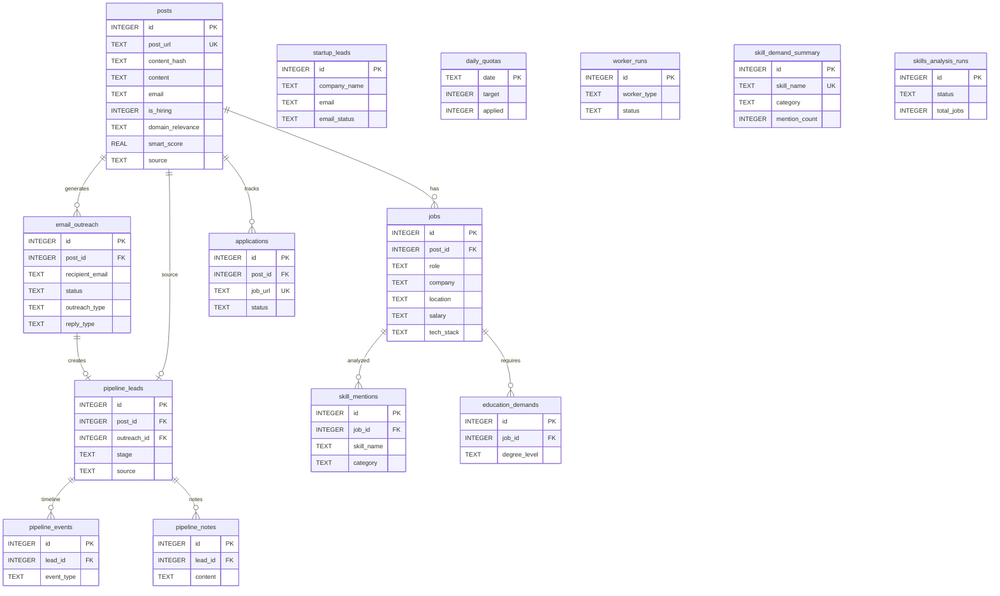

# CareerKit -- Database Schema

> SQLite database schema, relationships, queries, and data management.

## Overview

- **Engine**: SQLite3 with WAL (Write-Ahead Logging)
- **Location**: `data/linkedin_jobs.db`
- **Connection**: Thread-local via `init_db()`, foreign keys enabled (`PRAGMA foreign_keys=ON`)
- **No ORM** -- raw SQL with parameterized queries throughout
- **Row factory**: `sqlite3.Row` for dict-like access on all query results

## Entity Relationship Diagram



## Tables

### posts

Scraped job posts from LinkedIn and 100+ other sources. Central table that most other tables reference.

| Column | Type | Constraints | Description |
|--------|------|-------------|-------------|
| id | INTEGER | PRIMARY KEY AUTOINCREMENT | Auto-incrementing row ID |
| post_url | TEXT | UNIQUE (where not null/empty) | URL of the original post |
| content_hash | TEXT | NOT NULL | SHA-256 of first 200 chars lowercased (dedup) |
| author_name | TEXT | | Post author name |
| author_profile | TEXT | | Author LinkedIn profile URL |
| author_headline | TEXT | | Author title/headline |
| content | TEXT | NOT NULL | Post text content |
| links | TEXT | | Extracted URLs, comma-separated |
| email | TEXT | | Extracted email addresses, comma-separated |
| post_date | TEXT | | When the post was published |
| keyword_matched | TEXT | | Search query that found this post |
| is_hiring | INTEGER | DEFAULT 0 | 1 = confirmed hiring post |
| domain_relevance | TEXT | | "High", "Medium", or "Low" |
| created_at | TEXT | DEFAULT datetime('now') | Insert timestamp |
| updated_at | TEXT | DEFAULT datetime('now') | Last modification |
| full_content | TEXT | _(migration)_ | Full post content from deep extraction |
| apply_url | TEXT | _(migration)_ | Direct application URL |
| deep_extracted | INTEGER | DEFAULT 0 _(migration)_ | Whether deep LLM extraction ran |
| fit_score | REAL | _(migration)_ | LLM-assigned fitness score (0-10) |
| source | TEXT | DEFAULT 'linkedin' _(migration)_ | Source identifier (linkedin, remoteok, hn, etc.) |
| is_live | TEXT | _(migration)_ | Whether the post URL is still active |
| last_checked_at | TEXT | _(migration)_ | Last liveness check timestamp |
| smart_score | REAL | _(migration)_ | Rule-based weighted score from smart filter (0-10) |

**Indexes**:
- `idx_posts_url` -- UNIQUE on `post_url` WHERE post_url IS NOT NULL AND post_url != ''
- `idx_posts_content_hash` -- on `content_hash`
- `idx_posts_domain` -- on `domain_relevance`
- `idx_posts_is_hiring` -- on `is_hiring`

### jobs

Structured job details extracted from posts. One post can have multiple job rows (comma-separated roles are split into individual rows).

| Column | Type | Constraints | Description |
|--------|------|-------------|-------------|
| id | INTEGER | PRIMARY KEY AUTOINCREMENT | |
| post_id | INTEGER | NOT NULL, FK -> posts(id) ON DELETE CASCADE | Parent post |
| role | TEXT | | Job title ("AI Engineer", "ML Engineer", etc.) |
| company | TEXT | | Hiring company name |
| location | TEXT | | City, country, or "Remote" |
| experience | TEXT | | Experience requirement ("2-5 years") |
| created_at | TEXT | DEFAULT datetime('now') | |
| salary | TEXT | _(migration)_ | Salary information |
| tech_stack | TEXT | _(migration)_ | Technologies mentioned |
| fit_reasons | TEXT | _(migration)_ | LLM-generated fit rationale |

**Indexes**:
- `idx_jobs_role` -- on `role`
- `idx_jobs_company` -- on `company`

### email_outreach

Tracks every cold email generated and sent. Status progresses: draft -> sent -> replied or failed.

| Column | Type | Constraints | Description |
|--------|------|-------------|-------------|
| id | INTEGER | PRIMARY KEY AUTOINCREMENT | |
| post_id | INTEGER | FK -> posts(id) ON DELETE CASCADE | Related post |
| recipient_email | TEXT | NOT NULL | Target email address |
| subject | TEXT | | Email subject line |
| body | TEXT | | Email body content |
| status | TEXT | DEFAULT 'pending' | pending, draft, sent, failed, replied |
| sent_at | TEXT | | When email was actually sent |
| created_at | TEXT | DEFAULT datetime('now') | |
| followup_count | INTEGER | DEFAULT 0 _(migration)_ | Number of follow-ups sent |
| last_followup_at | TEXT | _(migration)_ | Timestamp of last follow-up |
| outreach_type | TEXT | DEFAULT 'cold' _(migration)_ | cold, warm, or referral |
| reply_detected_at | TEXT | _(migration)_ | When IMAP detected a reply |
| reply_preview | TEXT | _(migration)_ | First 300 chars of the reply |
| reply_type | TEXT | _(migration)_ | interested, auto_reply, rejection, or info |
| error_message | TEXT | _(migration)_ | SMTP error details |
| error_type | TEXT | _(migration)_ | bounced, invalid_address, auth_error, etc. |

**Indexes**:
- `idx_outreach_status` -- on `status`
- `idx_outreach_post_id` -- on `post_id`
- `idx_outreach_created` -- on `created_at DESC`
- `idx_outreach_recipient` -- on `recipient_email`
- `idx_outreach_reply` -- on `reply_detected_at`

### pipeline_leads

CRM-style lead tracking. Each lead represents a job opportunity tracked through hiring stages.

| Column | Type | Constraints | Description |
|--------|------|-------------|-------------|
| id | INTEGER | PRIMARY KEY AUTOINCREMENT | |
| post_id | INTEGER | FK -> posts(id) ON DELETE CASCADE | Source post |
| outreach_id | INTEGER | FK -> email_outreach(id) | Source email |
| recipient_name | TEXT | | Contact name |
| recipient_email | TEXT | NOT NULL | Contact email |
| role | TEXT | | Job role being tracked |
| company | TEXT | | Company name |
| location | TEXT | | Job location |
| stage | TEXT | DEFAULT 'applied' | Current pipeline stage |
| source | TEXT | DEFAULT 'email' | How the lead was created |
| created_at | TEXT | DEFAULT datetime('now') | |
| updated_at | TEXT | DEFAULT datetime('now') | Last stage change |

**Stages**: `applied` -> `replied` -> `interviewing` -> `offer` / `rejected`

**Indexes**:
- `idx_pipeline_stage` -- on `stage`
- `idx_pipeline_outreach` -- on `outreach_id`

### pipeline_events

Timeline events for each pipeline lead. Created automatically on stage changes, email sends, and reply detections.

| Column | Type | Constraints | Description |
|--------|------|-------------|-------------|
| id | INTEGER | PRIMARY KEY AUTOINCREMENT | |
| lead_id | INTEGER | NOT NULL, FK -> pipeline_leads(id) ON DELETE CASCADE | Parent lead |
| event_type | TEXT | NOT NULL | stage_change, email_sent, email_reply, note |
| title | TEXT | | Short event description |
| content | TEXT | | Event details |
| created_at | TEXT | DEFAULT datetime('now') | |

**Indexes**:
- `idx_pipeline_events_lead` -- on `lead_id`

### pipeline_notes

Free-text notes attached to pipeline leads.

| Column | Type | Constraints | Description |
|--------|------|-------------|-------------|
| id | INTEGER | PRIMARY KEY AUTOINCREMENT | |
| lead_id | INTEGER | NOT NULL, FK -> pipeline_leads(id) ON DELETE CASCADE | Parent lead |
| content | TEXT | NOT NULL | Note text |
| created_at | TEXT | DEFAULT datetime('now') | |

**Indexes**:
- `idx_pipeline_notes_lead` -- on `lead_id`

### startup_leads

Healthcare and startup companies imported from external datasets for proactive outreach.

| Column | Type | Constraints | Description |
|--------|------|-------------|-------------|
| id | INTEGER | PRIMARY KEY AUTOINCREMENT | |
| company_name | TEXT | NOT NULL | Company name |
| website | TEXT | | Company website URL |
| email | TEXT | | Contact email(s), comma-separated |
| description | TEXT | | Company description |
| industry | TEXT | | Industry sector |
| sector | TEXT | | Sub-sector |
| location | TEXT | | Full location string |
| city | TEXT | | City |
| state | TEXT | | State/province |
| country | TEXT | DEFAULT 'India' | Country |
| funding_info | TEXT | | Funding details |
| employees | TEXT | | Employee count range |
| funding_status | TEXT | | Funding stage (Seed, Series A, etc.) |
| linkedin_url | TEXT | | Company LinkedIn page |
| facebook_url | TEXT | | Facebook page |
| twitter_url | TEXT | | Twitter/X profile |
| youtube_url | TEXT | | YouTube channel |
| other_url | TEXT | | Other relevant URL |
| dipp_recognition | TEXT | | DIPP startup recognition status |
| entity_type | TEXT | | Legal entity type |
| source_file | TEXT | | Import source file identifier |
| email_status | TEXT | DEFAULT 'not_contacted' | Outreach status |
| tags | TEXT | | Tags for categorization |
| notes | TEXT | | Free-text notes |
| created_at | TEXT | DEFAULT datetime('now') | |
| updated_at | TEXT | DEFAULT datetime('now') | |

**Indexes**:
- `idx_startup_leads_company` -- on `company_name`
- `idx_startup_leads_industry` -- on `industry`
- `idx_startup_leads_location` -- on `location`
- `idx_startup_leads_email_status` -- on `email_status`
- `idx_startup_leads_email` -- on `email`

### applications

Every job application attempt, both manual and automated.

| Column | Type | Constraints | Description |
|--------|------|-------------|-------------|
| id | INTEGER | PRIMARY KEY AUTOINCREMENT | |
| post_id | INTEGER | FK -> posts(id) ON DELETE SET NULL | Source post (nullable) |
| platform | TEXT | NOT NULL, DEFAULT 'unknown' | linkedin, naukri, wellfound, etc. |
| job_url | TEXT | NOT NULL | Application URL (unique) |
| job_title | TEXT | | Job title |
| company | TEXT | | Company name |
| location | TEXT | | Job location |
| status | TEXT | DEFAULT 'pending' | pending, applied, failed, skipped |
| apply_method | TEXT | | manual, easy_apply, email, redirect |
| error_message | TEXT | | Error details if failed |
| retry_count | INTEGER | DEFAULT 0 | Number of retry attempts |
| applied_at | TEXT | DEFAULT datetime('now') | Application timestamp |
| created_at | TEXT | DEFAULT datetime('now') | |

**Indexes**:
- `idx_applications_url` -- UNIQUE on `job_url`
- `idx_applications_status` -- on `status`
- `idx_applications_date` -- on `applied_at`

### daily_quotas

Rate limiting for auto-apply. One row per day, auto-created on first application.

| Column | Type | Constraints | Description |
|--------|------|-------------|-------------|
| date | TEXT | PRIMARY KEY | Date string (YYYY-MM-DD) |
| target | INTEGER | DEFAULT 500 | Daily application target |
| applied | INTEGER | DEFAULT 0 | Successful applications today |
| failed | INTEGER | DEFAULT 0 | Failed attempts today |
| skipped | INTEGER | DEFAULT 0 | Skipped jobs today |

### worker_runs

Audit log for background workers (bulk email generation, bulk send, IMAP checks, follow-ups).

| Column | Type | Constraints | Description |
|--------|------|-------------|-------------|
| id | INTEGER | PRIMARY KEY AUTOINCREMENT | |
| worker_type | TEXT | NOT NULL | bulk_generate, bulk_send, imap_check, auto_followup |
| started_at | TEXT | DEFAULT datetime('now') | |
| finished_at | TEXT | | Completion timestamp |
| status | TEXT | DEFAULT 'running' | running, completed |
| total | INTEGER | DEFAULT 0 | Total items to process |
| succeeded | INTEGER | DEFAULT 0 | Successfully processed |
| failed | INTEGER | DEFAULT 0 | Failed items |
| error | TEXT | | Top-level error if worker crashed |
| results | TEXT | | JSON blob of last ~20 result entries |

### skill_mentions

Individual skill mentions extracted from job descriptions. Used by the Skills Intelligence feature.

| Column | Type | Constraints | Description |
|--------|------|-------------|-------------|
| id | INTEGER | PRIMARY KEY AUTOINCREMENT | |
| job_id | INTEGER | NOT NULL, FK -> jobs(id) ON DELETE CASCADE | Parent job |
| skill_name | TEXT | NOT NULL | Skill name ("Python", "PyTorch", etc.) |
| category | TEXT | NOT NULL | Skill category ("language", "framework", etc.) |
| required_level | TEXT | DEFAULT 'mentioned' | mentioned, required, preferred |
| source | TEXT | DEFAULT 'regex' | Extraction method (regex or llm) |
| created_at | TEXT | DEFAULT datetime('now') | |

**Constraints**: UNIQUE(job_id, skill_name)

**Indexes**:
- `idx_skill_mentions_skill` -- on `skill_name`
- `idx_skill_mentions_job` -- on `job_id`
- `idx_skill_mentions_category` -- on `category`

### skill_demand_summary

Aggregated skill demand across all analyzed jobs. One row per unique skill.

| Column | Type | Constraints | Description |
|--------|------|-------------|-------------|
| id | INTEGER | PRIMARY KEY AUTOINCREMENT | |
| skill_name | TEXT | NOT NULL, UNIQUE | Skill name |
| category | TEXT | NOT NULL | Skill category |
| mention_count | INTEGER | DEFAULT 0 | Total mentions across jobs |
| percentage | REAL | DEFAULT 0.0 | Percentage of jobs mentioning this skill |
| required_count | INTEGER | DEFAULT 0 | Times listed as required |
| preferred_count | INTEGER | DEFAULT 0 | Times listed as preferred |
| last_updated | TEXT | DEFAULT datetime('now') | |

### education_demands

Education requirements extracted from job descriptions.

| Column | Type | Constraints | Description |
|--------|------|-------------|-------------|
| id | INTEGER | PRIMARY KEY AUTOINCREMENT | |
| job_id | INTEGER | NOT NULL, FK -> jobs(id) ON DELETE CASCADE | Parent job |
| degree_level | TEXT | NOT NULL | BS, MS, PhD, etc. |
| requirement | TEXT | DEFAULT 'preferred' | required or preferred |
| field | TEXT | | Field of study |

**Indexes**:
- `idx_education_demands_job` -- on `job_id`

### skills_analysis_runs

Tracks background skill analysis jobs.

| Column | Type | Constraints | Description |
|--------|------|-------------|-------------|
| id | INTEGER | PRIMARY KEY AUTOINCREMENT | |
| status | TEXT | DEFAULT 'running' | running, completed |
| total_jobs | INTEGER | DEFAULT 0 | Jobs to analyze |
| processed | INTEGER | DEFAULT 0 | Jobs analyzed so far |
| started_at | TEXT | DEFAULT datetime('now') | |
| finished_at | TEXT | | Completion timestamp |

## Complete Index Reference

| Index Name | Table | Column(s) | Type | Purpose |
|------------|-------|-----------|------|---------|
| idx_posts_url | posts | post_url | UNIQUE (conditional) | URL-based dedup, fast lookup |
| idx_posts_content_hash | posts | content_hash | NORMAL | Content-based dedup |
| idx_posts_domain | posts | domain_relevance | NORMAL | Filter by relevance level |
| idx_posts_is_hiring | posts | is_hiring | NORMAL | Filter hiring posts |
| idx_jobs_role | jobs | role | NORMAL | Role search/filter |
| idx_jobs_company | jobs | company | NORMAL | Company search/filter |
| idx_outreach_status | email_outreach | status | NORMAL | Filter by email status |
| idx_outreach_post_id | email_outreach | post_id | NORMAL | Join with posts |
| idx_outreach_created | email_outreach | created_at DESC | NORMAL | Recent emails first |
| idx_outreach_recipient | email_outreach | recipient_email | NORMAL | Dedup by recipient |
| idx_outreach_reply | email_outreach | reply_detected_at | NORMAL | Find unreplied emails |
| idx_pipeline_stage | pipeline_leads | stage | NORMAL | Pipeline funnel queries |
| idx_pipeline_outreach | pipeline_leads | outreach_id | NORMAL | Join with email_outreach |
| idx_pipeline_events_lead | pipeline_events | lead_id | NORMAL | Timeline queries |
| idx_pipeline_notes_lead | pipeline_notes | lead_id | NORMAL | Notes per lead |
| idx_startup_leads_company | startup_leads | company_name | NORMAL | Company lookup |
| idx_startup_leads_industry | startup_leads | industry | NORMAL | Industry filter |
| idx_startup_leads_location | startup_leads | location | NORMAL | Location filter |
| idx_startup_leads_email_status | startup_leads | email_status | NORMAL | Outreach status filter |
| idx_startup_leads_email | startup_leads | email | NORMAL | Email lookup |
| idx_applications_url | applications | job_url | UNIQUE | Prevent duplicate applications |
| idx_applications_status | applications | status | NORMAL | Status filter |
| idx_applications_date | applications | applied_at | NORMAL | Date range queries |
| idx_skill_mentions_skill | skill_mentions | skill_name | NORMAL | Skill aggregation |
| idx_skill_mentions_job | skill_mentions | job_id | NORMAL | Join with jobs |
| idx_skill_mentions_category | skill_mentions | category | NORMAL | Category grouping |
| idx_education_demands_job | education_demands | job_id | NORMAL | Join with jobs |

## Key Functions

All functions are defined in `backend/db.py`.

### Connection & Schema

- **`init_db(db_path=None)`** -- Creates/opens the SQLite database, executes the full schema, runs migrations. Returns a `sqlite3.Connection` with `Row` factory. Thread-safe (`check_same_thread=False`).
- **`run_migrations(conn)`** -- Applies all `ALTER TABLE` migrations idempotently (catches "column already exists" errors). Called automatically by `init_db()`.

### Post Operations

- **`post_exists(conn, post_url, c_hash)`** -- Checks if a post exists by URL or content hash. Returns bool.
- **`insert_post(conn, post)`** -- Inserts a single post dict. Computes content hash, extracts links, splits comma-separated roles into individual `jobs` rows. Returns post ID or None if duplicate.
- **`insert_posts(conn, posts)`** -- Batch insert. Returns `(inserted_count, skipped_count)`. Commits once at the end.
- **`query_posts(conn, role=None, domain=None, has_email=None, is_hiring=None, company=None, location=None, source=None, limit=100, offset=0)`** -- Flexible filtered query joining posts and jobs. Returns list of dicts with aggregated role/company/location.
- **`get_stats(conn)`** -- Returns summary dict: total_posts, with_email, hiring, domain breakdown, role counts, outreach status counts.

### Application Tracking

- **`application_exists(conn, job_url)`** -- Checks if a job URL was already applied to.
- **`log_application(conn, platform, job_url, ...)`** -- Logs an application attempt. Auto-increments daily quota. Returns application ID or None if duplicate.
- **`get_applied_urls(conn)`** -- Returns `set` of all applied job URLs. Used by auto-apply to skip already-applied jobs.
- **`get_applications(conn, status=None, limit=200)`** -- Retrieves application history with optional status filter.
- **`get_application_stats(conn)`** -- Returns counts by status: applied, skipped, failed, pending, total.

### Quota Management

- **`get_today_quota(conn)`** -- Returns today's quota row (auto-creates if missing).
- **`quota_remaining(conn)`** -- Returns `max(0, target - applied)` for today.

### Outreach Queries

- **`get_unapplied_jobs(conn, limit=600)`** -- Gets hiring posts not yet applied to, ordered by smart_score, fit_score, domain relevance, and email availability.
- **`get_posts_for_outreach(conn)`** -- Gets posts with emails that haven't been contacted. Excludes blocklisted domains. Uses `INSTR()` for multi-email matching and `NOT EXISTS` subquery for dedup.

### Excel Import/Export

- **`export_to_excel(conn, output_path, filters=None)`** -- Exports posts to a formatted `.xlsx` file with styled headers, alternating row colors, and hyperlinks.
- **`import_excel(conn, xlsx_path)`** -- Imports posts from an existing Excel file. Auto-detects column layout from headers. Returns `(inserted, skipped)`.

### Hashing & Utilities

- **`content_hash(content)`** -- SHA-256 of first 200 chars lowercased. Primary dedup hash.
- **`content_hash_v2(content)`** -- SHA-256 of first 500 chars after whitespace normalization and lowercasing. Catches near-duplicates.
- **`extract_links(content)`** -- Regex extraction of all URLs from text. Deduplicates, strips trailing punctuation. Returns comma-separated string.

### DedupCache Class

In-memory deduplication cache for high-throughput scraping sessions.

```python
cache = DedupCache(conn)       # Loads all URLs, hashes, and content prefixes from DB
cache.exists(url, hash, content)  # O(1) check across all three layers
cache.add(url, hash, content)     # Register newly inserted post
cache.size                        # Total entries (URLs + hashes)
```

Three-layer check: (1) exact URL match, (2) content hash match, (3) normalized 100-char content prefix match (fuzzy, minimum 40 chars).

## Deduplication Strategy

Four-layer approach prevents duplicate posts across scraping sessions:

```
Layer 1: URL Matching
  UNIQUE index on post_url (conditional: WHERE post_url IS NOT NULL AND != '')
  Exact URL dedup at the database level.

Layer 2: Content Hash (SHA-256)
  SHA-256 of first 200 characters, lowercased.
  Catches same content posted at different URLs.

Layer 3: Normalized Content Hash
  content_hash_v2(): SHA-256 of first 500 characters after
  whitespace normalization and lowercasing.
  Catches formatting-only differences (extra spaces, line breaks).

Layer 4: DedupCache (In-Memory)
  Loaded from DB before scrape sessions.
  Checks URL set, hash set, and normalized 100-char prefix set.
  O(1) lookups instead of per-post SQL queries.
  Prefix matching (min 40 chars) catches near-duplicates
  where only trailing text differs.
```

## Migration Strategy

There is no formal migration framework. Schema evolution is handled via two mechanisms:

**New tables**: Add `CREATE TABLE IF NOT EXISTS` to the `SCHEMA` string in `db.py`. Idempotent by design.

**New columns**: Add `ALTER TABLE` statements to the `_MIGRATIONS` list or inline in `run_migrations()`. Each migration is wrapped in try/except to silently skip if the column already exists.

```python
# Pattern for adding a column
_MIGRATIONS = [
    "ALTER TABLE posts ADD COLUMN smart_score REAL",
    "ALTER TABLE email_outreach ADD COLUMN reply_type TEXT",
]

def run_migrations(conn):
    for sql in migrations:
        try:
            conn.execute(sql)
        except Exception:
            pass  # column already exists
    conn.commit()
```

All migrations run on every `init_db()` call, making schema changes automatically applied across all threads and restarts.

## Backup & Restore

**SQLite backup** (ensure WAL checkpoint first):

```bash
# Checkpoint WAL to flush pending writes
sqlite3 data/linkedin_jobs.db "PRAGMA wal_checkpoint(TRUNCATE);"

# Copy the database file
cp data/linkedin_jobs.db backup.db
```

**Export to Excel**:

```python
from db import init_db, export_to_excel
conn = init_db()
export_to_excel(conn, "backup.xlsx")
```

**Import from Excel**:

```python
from db import init_db, import_excel
conn = init_db()
inserted, skipped = import_excel(conn, "backup.xlsx")
```

**CLI shortcuts**:

```bash
python backend/db.py --export backup.xlsx
python backend/db.py --import-excel backup.xlsx
```

## Connection Patterns

Each thread creates its own connection via `init_db()`. Route files use a thread-local pattern:

```python
_local = threading.local()

def _get_db():
    if not hasattr(_local, 'conn') or _local.conn is None:
        _local.conn = init_db()
    return _local.conn
```

Background workers (scraper, email, IMAP) create their own connections at thread start:

```python
def _bulk_send_worker():
    conn = init_db()
    # ... use conn throughout the worker ...
```

**WAL mode** enables concurrent reads from multiple threads while a single writer holds the lock. This is critical because scraper threads, API request handlers, and email workers all access the database simultaneously.

**Foreign keys** are enabled via `PRAGMA foreign_keys=ON` in the schema, ensuring cascading deletes work (e.g., deleting a post cascades to its jobs and email_outreach rows).

## Key Query Patterns

**Posts for outreach** (has email, is hiring, not yet contacted):

```sql
SELECT p.id, p.author_name, p.email, p.content,
       (SELECT GROUP_CONCAT(j.role, ', ') FROM jobs j WHERE j.post_id = p.id) as role,
       (SELECT j2.company FROM jobs j2 WHERE j2.post_id = p.id LIMIT 1) as company
FROM posts p
WHERE p.email IS NOT NULL AND p.email != ''
  AND p.is_hiring = 1
  AND p.id NOT IN (SELECT post_id FROM email_outreach WHERE post_id IS NOT NULL AND status = 'sent')
  AND NOT EXISTS (
      SELECT 1 FROM email_outreach eo
      WHERE eo.status = 'sent' AND INSTR(p.email, eo.recipient_email) > 0
  )
ORDER BY CASE p.domain_relevance WHEN 'High' THEN 1 WHEN 'Medium' THEN 2 ELSE 3 END
```

**Unapplied jobs ranked by score**:

```sql
SELECT p.id, p.post_url, p.smart_score, p.fit_score, p.domain_relevance,
       (SELECT GROUP_CONCAT(j.role, ', ') FROM jobs j WHERE j.post_id = p.id) as role
FROM posts p
WHERE p.is_hiring = 1
  AND p.post_url NOT IN (SELECT job_url FROM applications)
ORDER BY p.smart_score DESC NULLS LAST,
         p.fit_score DESC NULLS LAST,
         CASE p.domain_relevance WHEN 'High' THEN 1 WHEN 'Medium' THEN 2 ELSE 3 END
```

**Pipeline funnel**:

```sql
SELECT stage, COUNT(*) FROM pipeline_leads GROUP BY stage
```

**Smart filter stats**:

```sql
SELECT COUNT(*) as total_hiring,
       COUNT(smart_score) as scored,
       AVG(smart_score) as avg_score,
       SUM(CASE WHEN smart_score >= 5.0 THEN 1 ELSE 0 END) as apply_count,
       SUM(CASE WHEN smart_score >= 3.5 AND smart_score < 5.0 THEN 1 ELSE 0 END) as consider_count,
       SUM(CASE WHEN smart_score < 3.5 THEN 1 ELSE 0 END) as skip_count
FROM posts WHERE is_hiring = 1
```

## Data Lifecycle

1. **Scraping**: Scrapers collect posts from 100+ sources. Each scraper calls `insert_posts(conn, posts)` which runs dedup and splits roles into individual job rows.

2. **Deduplication**: The 4-layer dedup strategy (URL, content hash, normalized hash, in-memory prefix) prevents duplicates during insertion.

3. **Extraction**: LLM extractors enrich posts with structured data (role, company, location, experience, salary, tech stack). Sets `deep_extracted = 1` when complete.

4. **Scoring**: Smart filter scores each hiring post across 6 weighted dimensions (role match, skill match, domain relevance, experience fit, quality signals, location fit). Writes `smart_score` to posts. Verdicts: APPLY (>= 5.0), CONSIDER (3.5-5.0), SKIP (< 3.5).

5. **Querying**: UI reads via `query_posts()` with filters. Posts are joined with jobs via scalar subqueries to avoid row multiplication from multi-role posts.

6. **Email outreach**: `get_posts_for_outreach()` finds contactable posts. Emails are generated as drafts, then sent in bulk. IMAP polling detects replies and updates `email_outreach.reply_type`.

7. **Applications**: Auto-apply engine consumes scored posts via `get_unapplied_jobs()` or `filter_unapplied()`. Each attempt is logged in `applications` with daily quota enforcement.

8. **Pipeline**: Sent emails are synced into `pipeline_leads` via `/api/pipeline/sync`. Leads progress through stages: applied -> replied -> interviewing -> offer/rejected. Events and notes provide a timeline.

## See Also

- [Architecture](ARCHITECTURE.md) -- System design, threading model, component interactions
- [Services Reference](SERVICES_REFERENCE.md) -- Every service function and constant
- [API Reference](API_REFERENCE.md) -- All REST endpoints
