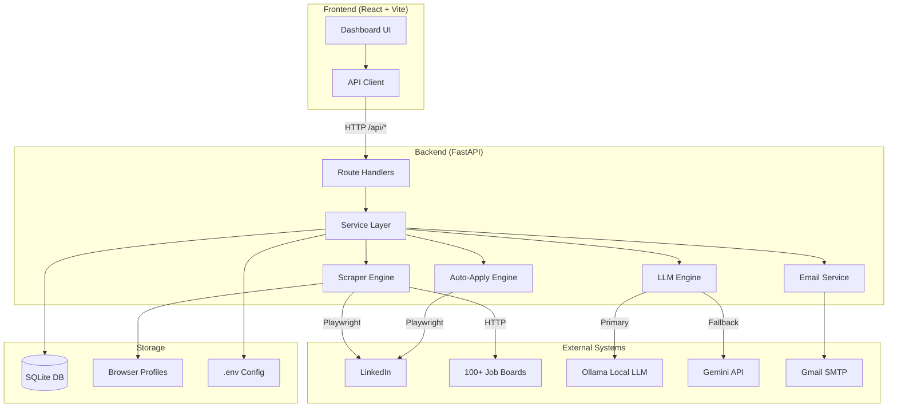
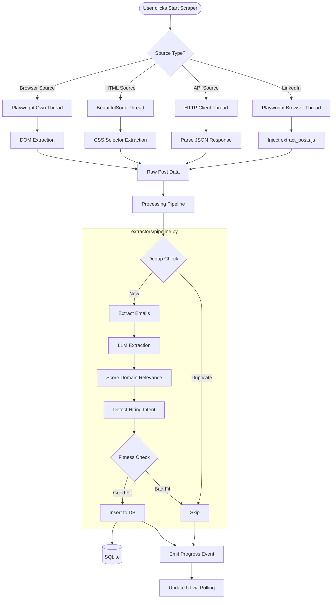
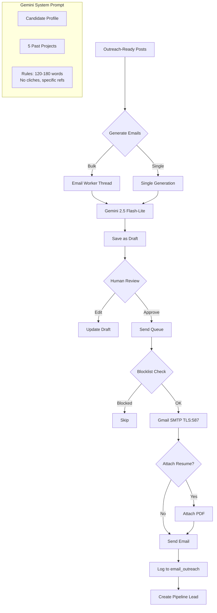
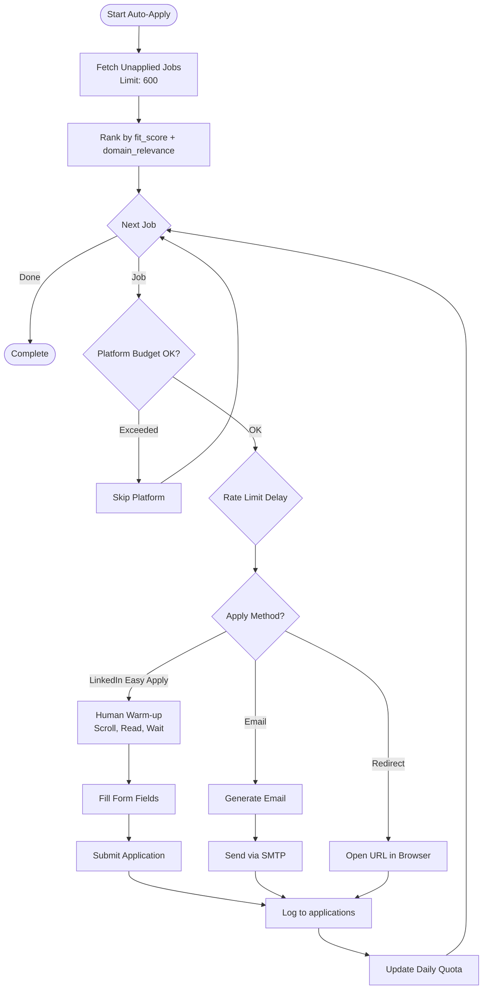
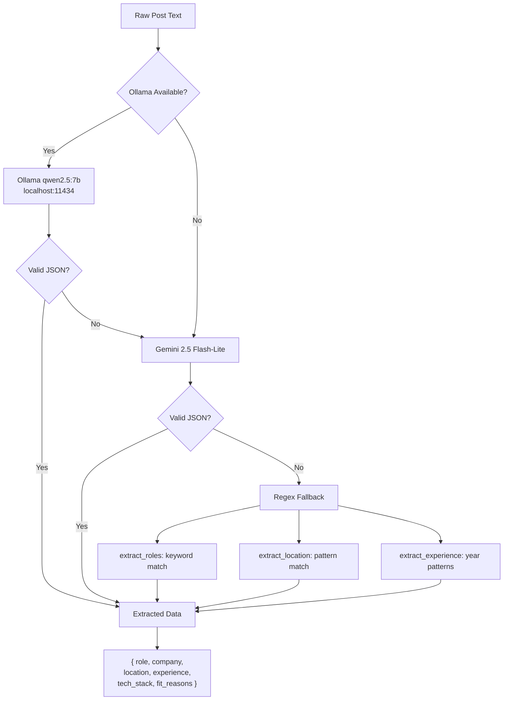
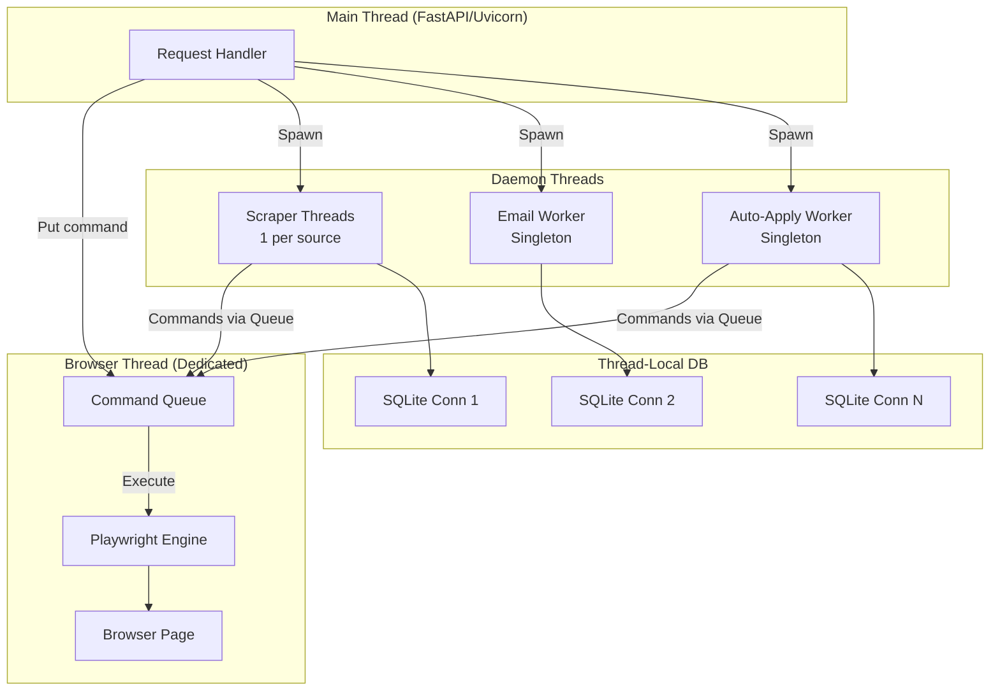
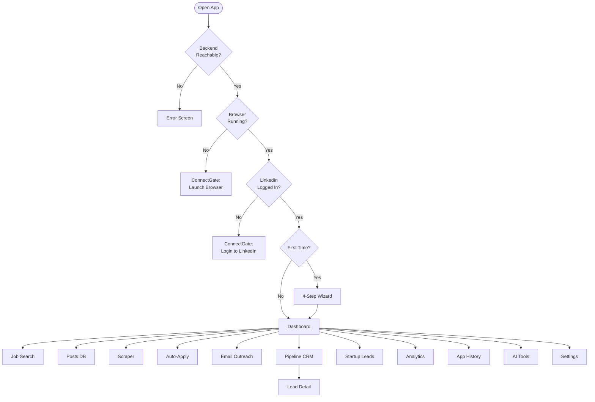

# CareerKit System Diagrams

## 1. High-Level System Architecture



## 2. Data Flow — Scraping Pipeline



## 3. Data Flow — Email Outreach



## 4. Data Flow — Auto-Apply



## 5. LLM Extraction Chain



## 6. Threading Model



## 7. Frontend Page Flow



## 8. Source Distribution

```
100+ Job Sources
├── LinkedIn Family (6)
│   ├── LinkedIn Search
│   ├── LinkedIn Feed
│   ├── LinkedIn Hashtags
│   ├── LinkedIn Deep Fetch
│   ├── LinkedIn Career Links
│   └── LinkedIn Email Enricher
│
├── API Sources — No Browser (12)
│   ├── RemoteOK
│   ├── Himalayas
│   ├── HN Jobs
│   ├── Remotive
│   ├── Working Nomads
│   ├── WWR RSS
│   ├── USAJobs
│   ├── SmartRecruiters
│   └── Euraxess
│
├── ATS Aggregators (3)
│   ├── Greenhouse API
│   ├── Lever API
│   └── Ashby API
│
├── Browser Sources (10)
│   ├── Indeed
│   ├── Wellfound
│   ├── YC Jobs
│   ├── Naukri
│   ├── Arc.dev
│   └── ...
│
└── HTML Sources — BeautifulSoup (62+)
    ├── Remote: Remote.co, NoDesk, FlexJobs
    ├── AI/ML: AIJobs, AIMLJobs, KDNuggets
    ├── Regional: TokyoDev, JapanDev, Bayt, Naukri
    ├── Academic: Nature, ResearchGate, Euraxess
    └── General: Monster, Dice, Glassdoor
```

## 9. Smart Filter Scoring

```
Score (0-10) = weighted sum of:

┌─────────────────────────────┬────────┬───────────────────────────────┐
│ Factor                      │ Weight │ Logic                         │
├─────────────────────────────┼────────┼───────────────────────────────┤
│ Role Match                  │  3.0   │ Is role in TARGET_ROLES?      │
│ Domain Relevance            │  2.5   │ High=3, Medium=2, Low=1       │
│ Experience Fit              │  2.0   │ Within 0-3 year range?        │
│ Location Preference         │  1.5   │ In ACTIVE_REGIONS?            │
│ Tech Stack Match            │  1.0   │ Overlap with RESUME_SKILLS    │
└─────────────────────────────┴────────┴───────────────────────────────┘

Threshold: score >= 5.0 → Auto-apply candidate
           score >= 7.0 → Priority application
           score < 3.0  → Skip
```

## 10. Daily Automation Cycle

```
┌─────────────────────────────────────────────────────┐
│              DAILY CRON (8 AM Weekdays)              │
│                scripts/daily_run.py                  │
└───────────────────────┬─────────────────────────────┘
                        │
                        v
┌───────────────────────────────────────────────────────┐
│              ORCHESTRATOR                              │
│              services/orchestrator.py                  │
│                                                       │
│  1. SCRAPE  ─────── 100+ sources in parallel         │
│      │              ├── LinkedIn (browser)             │
│      │              ├── APIs (HTTP)                    │
│      │              └── HTML (BeautifulSoup)           │
│      │                                                │
│  2. EXTRACT ─────── LLM + Regex extraction           │
│      │              ├── Ollama (local)                 │
│      │              └── Gemini (fallback)              │
│      │                                                │
│  3. FILTER  ─────── Smart scoring (0-10)             │
│      │              ├── Role relevance                 │
│      │              ├── Domain fit                     │
│      │              └── Experience match               │
│      │                                                │
│  4. APPLY   ─────── Auto-apply engine                │
│      │              ├── LinkedIn Easy Apply            │
│      │              ├── Email applications             │
│      │              └── Rate-limited + humanized       │
│      │                                                │
│  5. OUTREACH ────── Cold email generation            │
│                     ├── Gemini-personalized emails     │
│                     └── Gmail SMTP send                │
└───────────────────────────────────────────────────────┘
                        │
                        v
┌──────────────────────────────────────────────┐
│  EMAIL ENRICHMENT CRON (Every 2 Hours)        │
│  scripts/run_email_finder.sh                  │
│  ├── Find emails: web scrape + DuckDuckGo     │
│  └── Verify: SMTP ping (every 12 hours)       │
└──────────────────────────────────────────────┘
```
