# CareerKit — System Diagrams

> Visual reference for all major system flows, state machines, and architecture.
> All diagrams use Mermaid syntax.

---

## 1. High-Level System Architecture

```mermaid
graph TD
    USER[User Browser] -->|HTTP :5173| REACT[React SPA<br/>Vite Dev Server]
    REACT -->|/api proxy| FASTAPI[FastAPI :8000]

    FASTAPI --> ROUTES[11 Route Modules]
    ROUTES --> SERVICES[Service Layer]

    SERVICES --> SQLITE[(SQLite<br/>WAL mode, thread-local)]
    SERVICES -->|Command Queue| PLAYWRIGHT[Playwright<br/>Chromium]
    SERVICES -->|HTTP :11434| OLLAMA[Ollama<br/>qwen2.5:7b]
    SERVICES -->|HTTPS| GEMINI[Gemini 2.5<br/>Flash Lite]
    SERVICES -->|SMTP :587| GMAIL[Gmail SMTP]
    SERVICES -->|IMAP :993| IMAP[Gmail IMAP]

    PLAYWRIGHT --> LINKEDIN[LinkedIn]
    PLAYWRIGHT --> JOBBOARDS[Job Board Sites]

    FASTAPI -->|Static mount /| FRONTEND_DIST[frontend/ dist]

    style SQLITE fill:#1e293b,stroke:#7c3aed
    style FASTAPI fill:#1e293b,stroke:#7c3aed
    style REACT fill:#1e293b,stroke:#7c3aed
```

---

## 2. Scraping Pipeline

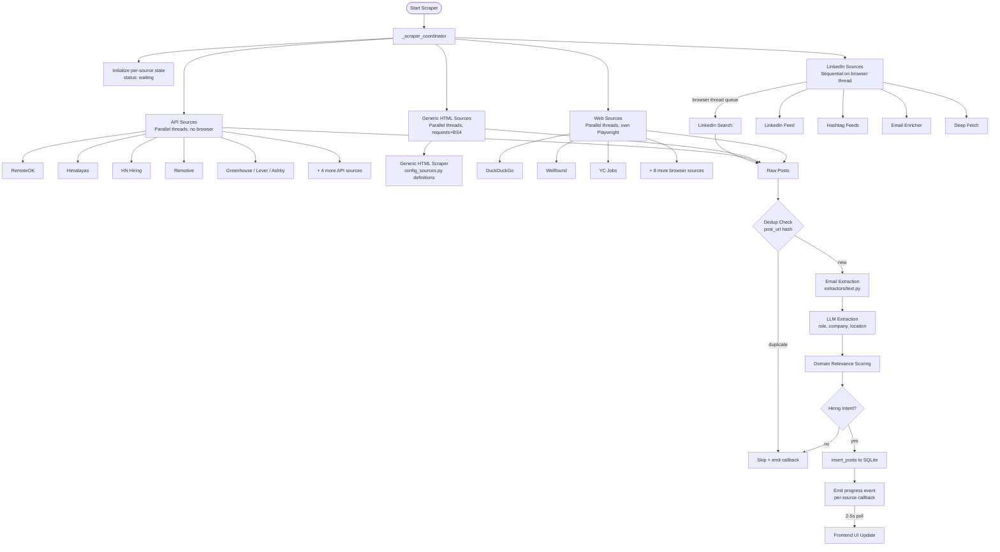

---

## 3. LLM Extraction Chain

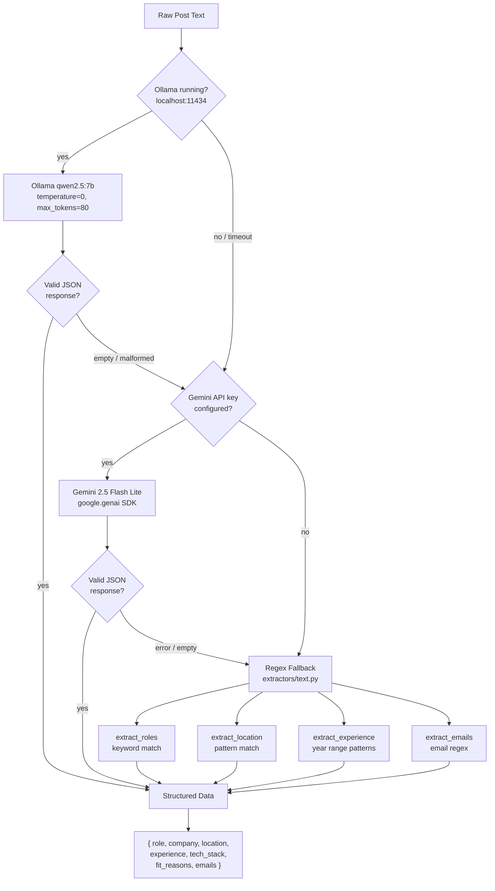

---

## 4. Email Outreach Pipeline

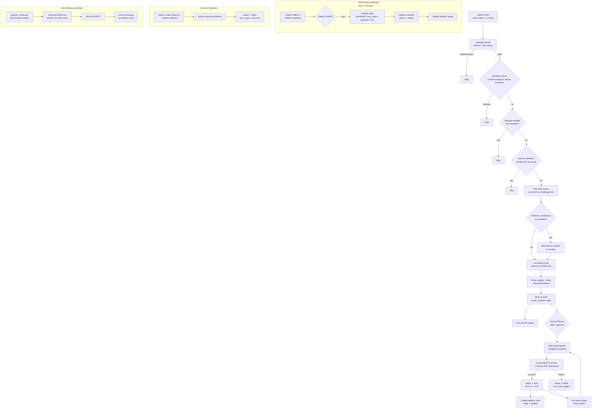

---

## 5. Auto-Apply Pipeline

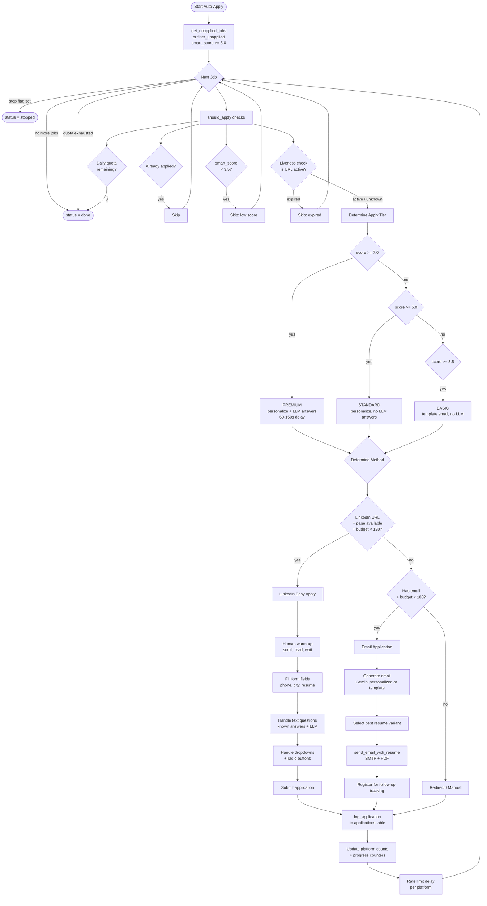

---

## 6. Smart Filter Scoring

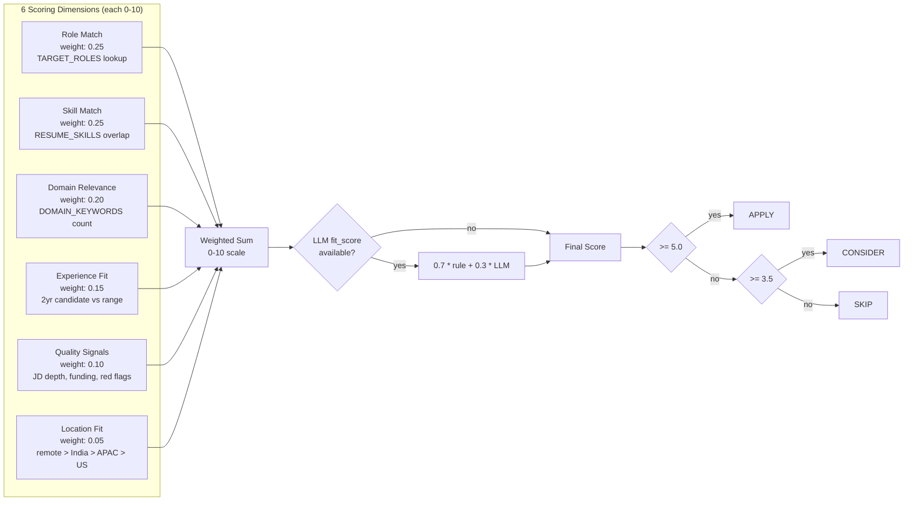

---

## 7. Threading Model

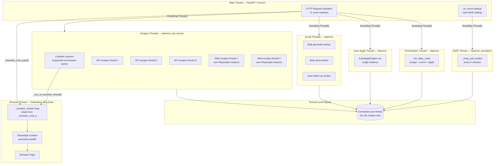

---

## 8. Browser State Machine

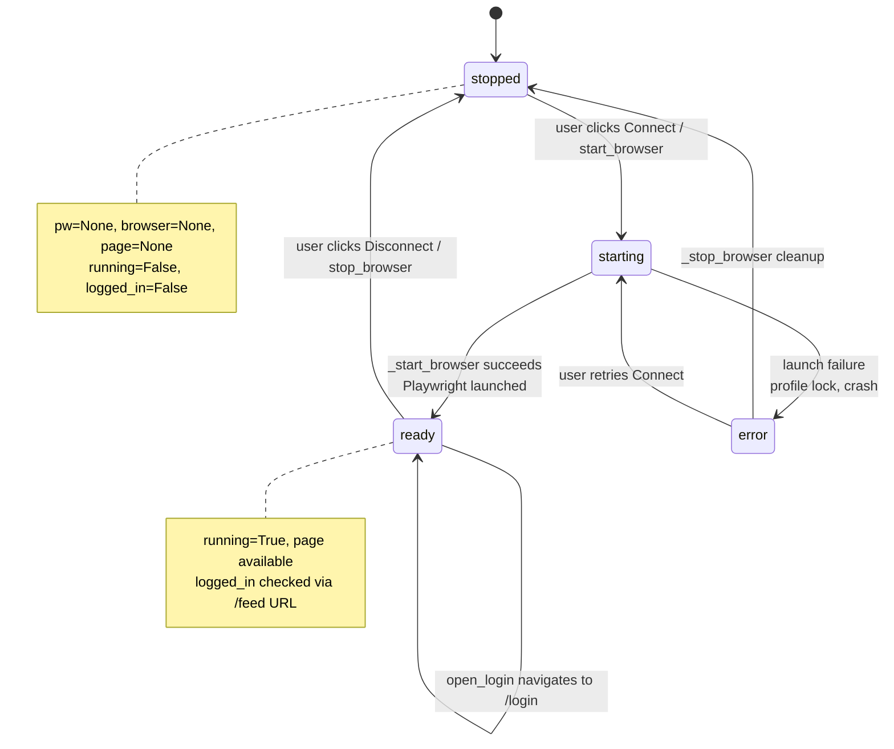

---

## 9. Scraper State Machine

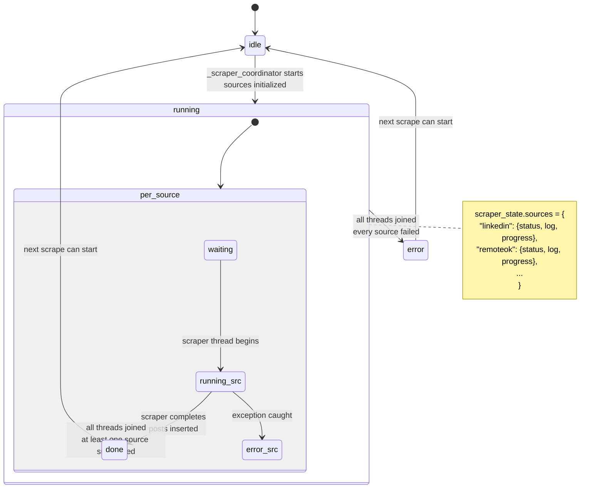

---

## 10. Error Flow Diagram

```mermaid
flowchart TD
    subgraph BROWSER_ERR["Browser Errors"]
        BC[Browser crash / profile lock] --> CLEAN[Clean Singleton* lock files]
        CLEAN --> RELAUNCH[Relaunch Playwright]
        RELAUNCH -->|success| READY[status = ready]
        RELAUNCH -->|fail| ERR_STATE[status = error<br/>user can retry]
    end

    subgraph LLM_ERR["LLM Errors"]
        OT[Ollama timeout / not running] --> GF[Gemini fallback]
        GF -->|API error or no key| RF[Regex fallback<br/>extract_roles + extract_location]
        GF -->|success| STRUCTURED[Structured extraction]
        RF --> PARTIAL[Partial extraction<br/>best effort]
    end

    subgraph SMTP_ERR["SMTP Errors"]
        AUTH[SMTPAuthenticationError] --> LOG_AUTH[Log error<br/>email features disabled]
        REFUSED[SMTPRecipientsRefused] --> MARK_FAIL_E[status=failed<br/>error_type=invalid_address]
        TIMEOUT_E[Socket timeout] --> MARK_FAIL_T[status=failed<br/>error_type=timeout]
        DISCONNECT[SMTPServerDisconnected] --> MARK_FAIL_D[status=failed<br/>error_type=connection]
    end

    subgraph SCRAPER_ERR["Scraper Errors"]
        S403[HTTP 403 / blocked] --> SKIP_SRC[Mark source error<br/>continue others]
        SNET[Network timeout] --> SKIP_SRC
        SDOM[DOM selector miss] --> EMPTY[0 posts found<br/>source = done]
    end

    subgraph DB_ERR["SQLite Errors"]
        LOCK[Database locked] --> WAL[WAL mode + thread-local conn]
        WAL --> RETRY[Auto-retry via init_db]
        OPCOL[Column not found] --> ALTER[ALTER TABLE ADD COLUMN<br/>e.g. smart_score]
    end
```

---

## 11. Daily Automation Cycle

```mermaid
sequenceDiagram
    participant USER as User / Cron
    participant ORCH as Orchestrator
    participant SCRAPER as Scraper Service
    participant FILTER as Smart Filter
    participant APPLY as AutoApplyEngine
    participant DB as SQLite

    USER->>ORCH: start_daily_cycle(max=500)
    activate ORCH
    ORCH->>ORCH: status = starting

    rect rgb(30, 30, 50)
    Note over ORCH,SCRAPER: Phase 1: Scraping
    ORCH->>ORCH: status = scraping
    ORCH->>SCRAPER: _scraper_coordinator(API sources)
    SCRAPER-->>DB: insert_posts (parallel threads)
    SCRAPER-->>ORCH: API scraping complete

    alt Browser running
        ORCH->>SCRAPER: _scraper_coordinator(browser sources)
        SCRAPER-->>DB: insert_posts
        SCRAPER-->>ORCH: Browser scraping complete
    else Browser not running
        ORCH->>ORCH: Skip browser scrapers
    end
    end

    rect rgb(30, 40, 30)
    Note over ORCH,FILTER: Phase 1.5: Scoring
    ORCH->>ORCH: status = scoring
    ORCH->>FILTER: score_all_unscored(limit=500)
    FILTER-->>DB: UPDATE posts SET smart_score
    FILTER-->>ORCH: scored N posts (APPLY/CONSIDER/SKIP)
    end

    rect rgb(40, 30, 30)
    Note over ORCH,APPLY: Phase 2: Auto-Apply
    ORCH->>ORCH: status = applying
    ORCH->>FILTER: filter_unapplied(threshold=5.0)
    FILTER-->>ORCH: N jobs above threshold
    ORCH->>APPLY: engine.run(max_applications=target)
    APPLY-->>DB: log_application per job
    APPLY-->>ORCH: apply cycle complete
    end

    rect rgb(30, 30, 40)
    Note over ORCH,DB: Phase 3: Report
    ORCH->>ORCH: status = reporting
    ORCH->>DB: get_today_quota + get_application_stats
    DB-->>ORCH: applied/failed/skipped counts
    ORCH->>ORCH: Emit report event
    end

    ORCH->>ORCH: status = done, running = false
    deactivate ORCH
```

---

## 12. Frontend Component Tree

```mermaid
graph TD
    APP[App] --> TOAST[ToastProvider]
    TOAST --> SHELL[AppShell]

    SHELL --> CHECK{Checking?}
    CHECK -->|yes| SPINNER[Loading Spinner]
    CHECK -->|no| GATE{Connected?}

    GATE -->|hard disconnect| CG[ConnectGate<br/>Launch + Login flow]
    GATE -->|soft expiry| BANNER[Session Expired Banner<br/>+ full app]
    GATE -->|connected| FULL[Full App Layout]

    FULL --> SIDEBAR[Sidebar<br/>navigation links]
    FULL --> BBAR[BrowserBar<br/>status dot + controls]
    FULL --> ROUTER[React Router]

    ROUTER --> DASH[/ Dashboard<br/>stats + quick actions]
    ROUTER --> FIND[/find FindJobs<br/>tabs: search, scraper, posts]
    ROUTER --> APPLY_P[/apply ApplyPage<br/>tabs: engine, history]
    ROUTER --> OUTREACH[/outreach OutreachPage<br/>tabs: email, leads]
    ROUTER --> PIPE[/pipeline Pipeline<br/>CRM kanban]
    ROUTER --> PIPE_D[/pipeline/:id LeadDetail]
    ROUTER --> INSIGHTS[/insights InsightsPage<br/>tabs: analytics, quality]
    ROUTER --> TOOLS[/ai-tools AITools]
    ROUTER --> SKILLS[/skills SkillsIntelligence]
    ROUTER --> SETTINGS[/settings SettingsPage]
```

---

## 13. Source Engine Decision Tree

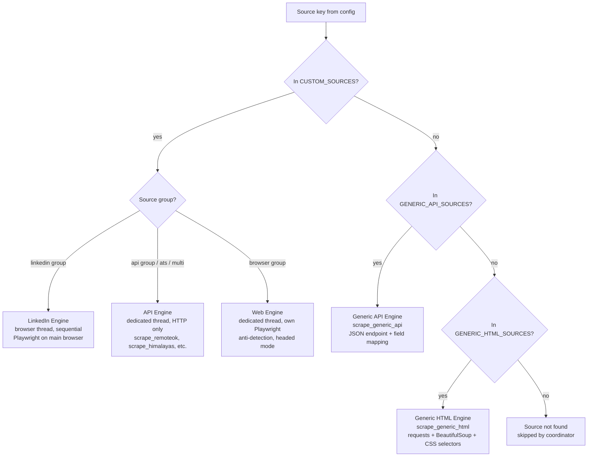

---

## 14. Email Finder Strategy Chain

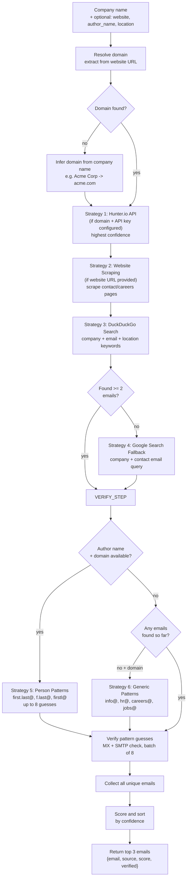

---

## 15. Data Lifecycle

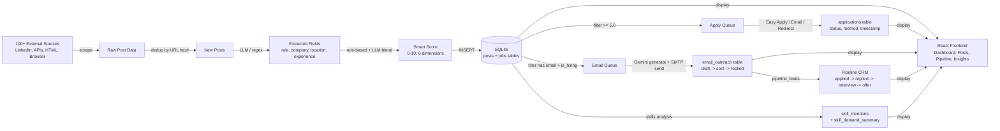

---

## 16. Skills Intelligence Analysis Flow

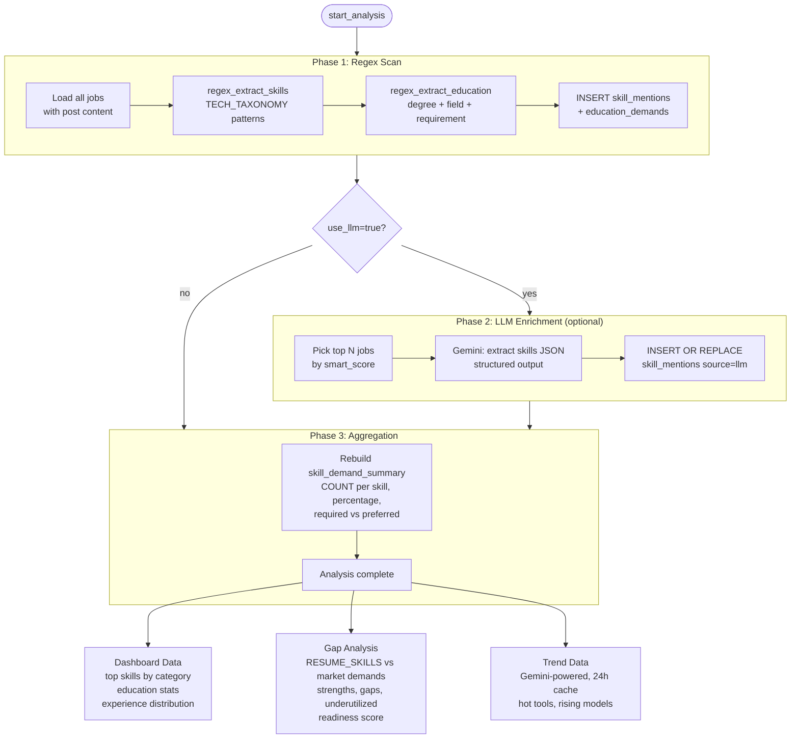

---

## See Also

- [Architecture](ARCHITECTURE.md) -- system design, component interactions, threading
- [Services Reference](SERVICES_REFERENCE.md) -- every service, function, and constant
- [API Reference](API_REFERENCE.md) -- all REST endpoints
- [Database Schema](DATABASE_SCHEMA.md) -- all tables, relationships, key queries
